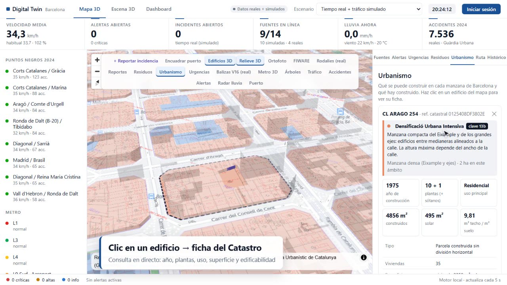
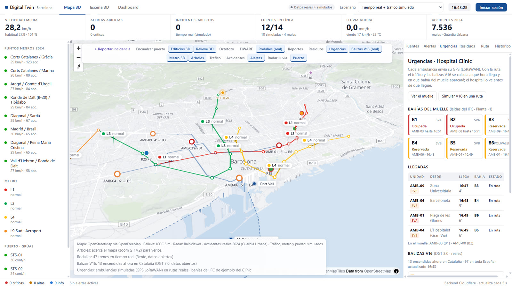
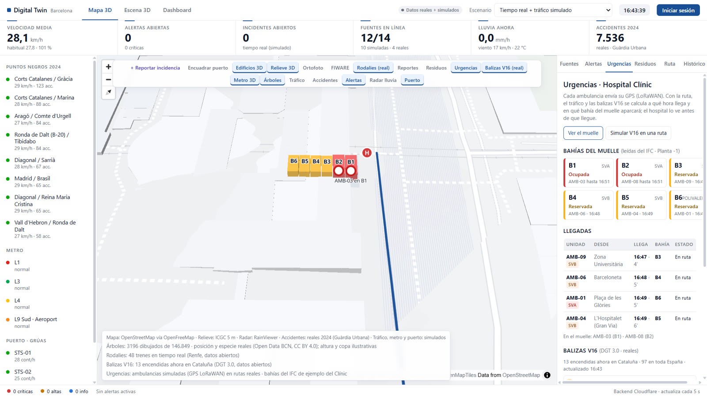
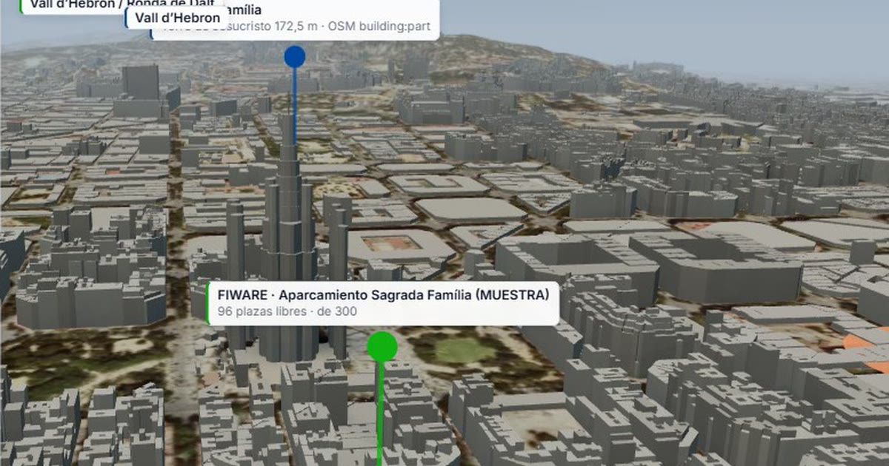

# Gemelo digital de Barcelona

[](https://github.com/christianAbadSantos/bcn-digital-twin/actions/workflows/ci.yml)

Un modelo 3D de Barcelona que junta en un solo mapa datos reales y en vivo de la ciudad: urbanismo, urgencias, residuos, movilidad, puerto y edificios BIM. Funciona en el navegador, sin instalar nada.

**👉 Pruébalo: [bcn-digital-twin.pages.dev](https://bcn-digital-twin.pages.dev)**



## Módulos

| Módulo | Qué hace | Datos |
| --- | --- | --- |
| **Urbanismo** | Colorea cada manzana según lo que se puede construir y, al hacer clic en un edificio, enseña su ficha: año, plantas, uso, superficies, edificabilidad y clave urbanística | Mapa Urbanístic de Catalunya (Generalitat) · Catastro, en directo |
| **Urgencias** | Ambulancias con GPS LoRaWAN, ETA según tráfico y balizas V16, y asignación de bahía en el muelle del hospital leída de un modelo IFC | Balizas V16 reales (DGT) · rutas reales (OSRM) · ambulancias simuladas |
| **Residuos** | Contenedores con sensor de llenado, indicadores y planificación de la ruta de recogida (vecino más próximo + 2-opt, varios viajes según la capacidad del camión) | 7.500 contenedores reales (OSM) · Open Data BCN · **API .NET + SQL Server** |
| **Movilidad** | Tráfico por zonas, metro 3D en movimiento, trenes de Rodalies en tiempo real, alertas que cruzan varias fuentes y recomendador de rutas | Rodalies real (Renfe GTFS-RT) · tiempo y radar reales · tráfico simulado |
| **Accidentes** | 7.536 accidentes de 2024 cruzados con la lluvia de cada hora (razón de tasas ajustada, IC 95 %) | Guàrdia Urbana (Open Data BCN) · Open-Meteo |
| **Ciudad 3D y BIM** | Edificios reales por teselas con LOD y Web Workers, relieve de 5 m, ortofoto y modelos IFC del Port de Barcelona | OpenStreetMap · ICGC · Biblioteca IFC del Port |
| **Smart city** | Adaptador FIWARE (NGSI-v2 y NGSI-LD) con Smart Data Models y reportes ciudadanos con foto | Context Broker configurable · Clerk + Cloudinary |

<table>
  <tr>
    <td></td>
    <td></td>
  </tr>
  <tr>
    <td align="center"><sub>Urgencias: ambulancias en ruta y su ETA</sub></td>
    <td align="center"><sub>Bahías del muelle leídas de un modelo IFC</sub></td>
  </tr>
</table>

## Arquitectura

```
                   ┌──────────────────────────────────────────────┐
  Navegador        │  React + MapLibre + Three.js + web-ifc (WASM) │
                   └───────┬──────────────┬───────────────┬────────┘
                           │              │               │
              ┌────────────▼───┐  ┌───────▼────────┐  ┌───▼─────────────────────┐
              │ Cloudflare     │  │ API .NET 10    │  │ Datos abiertos directos │
              │ Pages Functions│  │ (residuos)     │  │ Catastro · ICGC · OSM   │
              │ proxies, caché,│  │ EF Core        │  │ Open-Meteo · RainViewer │
              │ D1 y R2        │  │ SQL Server     │  └─────────────────────────┘
              └──┬─────────────┘  └────────────────┘
                 │  Renfe GTFS-RT · DGT DATEX II · FIWARE · IFC del Port
```

- **Frontend:** React 18, MapLibre GL, Three.js, deck.gl, web-ifc, Vite.
- **Backend web:** Cloudflare Pages Functions (proxies para fuentes sin CORS, caché, D1 y R2).
- **API de residuos:** ASP.NET Core 10, EF Core (SQL Server en producción, PostgreSQL en local), panel MVC, webhook LoRaWAN y xUnit. Ver [`fcc-residus-api/`](fcc-residus-api/README.md).
- **Calidad:** tests con Vitest (web) y xUnit (API), ejecutados en GitHub Actions en cada push.

## Qué es real y qué es simulado

Todo lo que se puede es real: mapa, edificios, relieve, calificación urbanística, Catastro, accidentes, lluvia, trenes de Rodalies, balizas V16 y posición de los contenedores. Lo simulado está marcado en la propia web: los sensores de tráfico y de llenado, las ambulancias y el metro. La tabla completa está en la [guía técnica](docs/GUIA-TECNICA.md#qué-es-real-y-qué-es-simulado).

## Arrancar en local

```bash
npm install
npm run dev      # http://localhost:5173
npm test         # tests de la lógica (Vitest)
```

La API de residuos, opcional en local:

```bash
cd fcc-residus-api
dotnet test
dotnet run --project src/Residus.Api
```

Sin backend, la web usa el mismo motor en el navegador y lo indica en el panel *Fuentes*.

## Documentación

- [Guía técnica](docs/GUIA-TECNICA.md): cada módulo en detalle, origen y límites de los datos, despliegue en Cloudflare (D1, R2, secretos) y estructura del código.
- [API de residuos](fcc-residus-api/README.md): endpoints, modelo de datos y despliegue.



---

Christian Abad Santos · © 2026, todos los derechos reservados (ver [LICENSE](LICENSE)). Los datos son de sus respectivas fuentes abiertas, citadas en la web y en la guía técnica.
